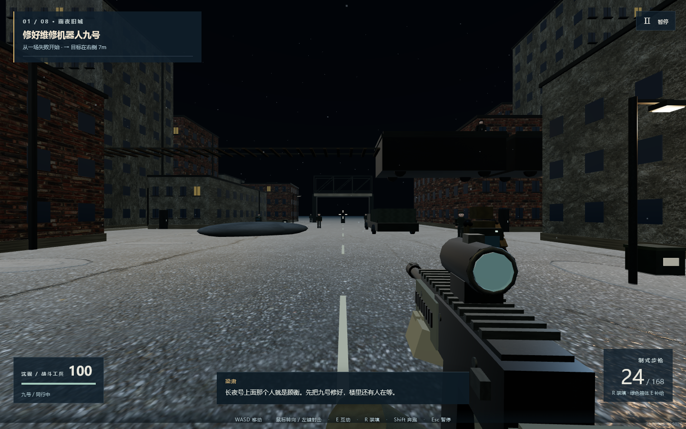

# 白昼之前 · 长夜行动

可在本地离线运行的八关单人第一人称 3D 射击战役。顾衡在第一关就以装甲列车指挥官的身份登场；从旧城撤离开始，玩家逐步切断他的侦察、补给与防空，最终登上军列，将他拘押并打开救援通道。

这是一个小体量、可完整通关的原创网页游戏，采用程序生成场景与人物、PBR 贴图和合成音效。故事与关卡从头到尾连通；美术、动画、关卡规模和演出仍与商业大作有明显距离。



## 本地游玩

需要 **Node.js 18 或更新版本**、支持 WebGL2 的 Chrome 或 Edge。所有依赖和贴图随仓库提供，**不用安装 npm 依赖，不需要账号、密钥或联网**。

Windows 下载并解压 [最新发行包](https://github.com/1923249243/daybreak-long-night/releases/latest)，双击 **启动游戏.cmd**。启动器会打开独立游戏窗口，并向浏览器请求高性能 GPU；实际选择取决于系统设置，画面右下角显示检测到的 GPU。退出窗口后，可双击 **停止本地服务.cmd**。

也可以在项目目录运行：

```sh
npm start
```

然后打开 <http://127.0.0.1:18461/>。服务仅监听本机。请通过本地服务进入，不要直接双击 `index.html`。如果端口被另一份游戏占用，先停止那一份，或设置 `PORT` 后运行 `npm start`。

## 操作

| 操作 | 按键 |
| --- | --- |
| 移动 / 奔跑 | WASD / Shift |
| 转向 / 射击 | 鼠标 / 左键 |
| 互动、救援、补给 | E |
| 装填 / 跳跃 / 蹲下 | R / 空格 / C 或 Ctrl |
| 暂停 | Esc |
| 无法锁定鼠标时转向 | 按住右键拖动，或 IJKL |

绿色补给箱可以补充弹药与生命，使用后有冷却。搬运伤员或器材时无法开枪。阶段检查点自动保存；死亡后可重试，菜单可以继续战役和重玩已解锁章节。存档保存在当前浏览器资料目录，清除网站数据会删除存档。

考虑晕 3D 的体验，镜头采用固定 92° 视野，关闭行走晃动、镜头后坐、冲刺变焦和动态模糊；枪械动画单独运动。设置里可以调低灵敏度、切换画质和关闭辅助瞄准。

## 八关战役

| 章节 | 地图 | 推进目标 |
| --- | --- | --- |
| 01 白旗 | 雨夜旧城 | 目睹顾衡开火，修好九号，救出医生并撤离 |
| 02 盲点 | 高架城区 | 穿过商场、打开车库、夺取侦察控制器 |
| 03 十二个名字 | 地下医院 | 恢复供电，分三组转移十二名伤员 |
| 04 夺轨 | 雪地站场 | 搬运电池、抢修医疗列车、切断敌军补给 |
| 05 猎场 | 山林公路 | 以梁肃视角识破伏击，带工兵与伤员突围 |
| 06 地下的路 | 地下矿井 | 运送器材、抢通矿道、救出受损的九号 |
| 07 断翼 | 山巅要塞 | 打开空域，在交火中击伤顾衡并迫使其撤退 |
| 08 白昼之前 | 装甲军列与双桥 | 停重炮、打伤并拘押顾衡、带九号撤离，等医疗列车通过后炸断军用支桥 |

完整人物、对白与情节见 [STORY.md](STORY.md)。过关会保留战略成果；顾衡在最后两关需要实际射击才能击败，最后一关还需要靠近拘押。

## 检查与开发

```sh
npm run check
npm test
```

`check` 检查运行文件、语法、九张贴图的 SHA-256 与离线依赖。测试覆盖八关自然输入代理通关、最终救援结果、Boss 受伤、碰撞遮挡、补给冷却、检查点、暂停与存档。代理读取场景状态做精确导航和瞄准，不代表人的游玩时长或手感评价。检查点会提供最低生命与弹药保障；弹药完全耗尽后也有延时应急补给。

浏览器实测和验收范围见 [docs/VALIDATION.md](docs/VALIDATION.md)。引擎接口见 [ARCHITECTURE.md](ARCHITECTURE.md)。无需构建步骤；修改源文件后刷新页面即可。

## 开源许可

本项目原创代码、故事、程序生成模型与合成音效采用 [MIT](LICENSE) 许可。Three.js r180 同为 MIT；Poly Haven 的砖墙、混凝土和柏油路面贴图采用 CC0。详情与校验值见 [第三方说明](THIRD_PARTY_NOTICES.md) 和 [素材清单](assets/manifest.json)。

欢迎提交问题与改进。仓库仅包含这一独立版本所需的文件。
