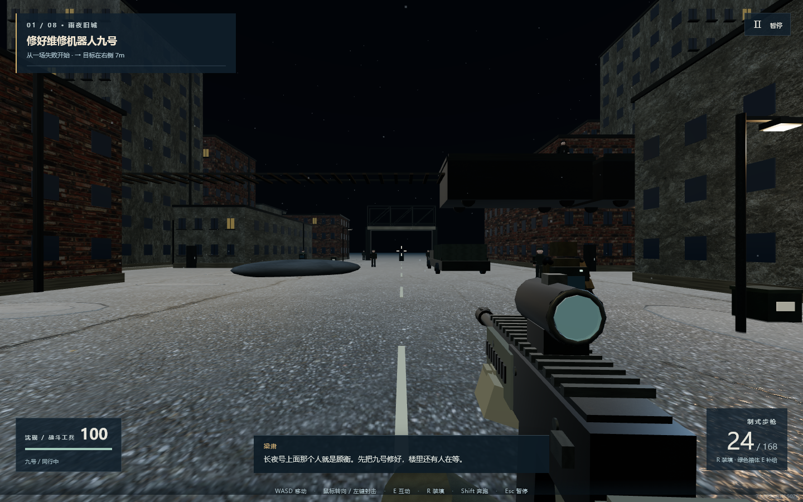
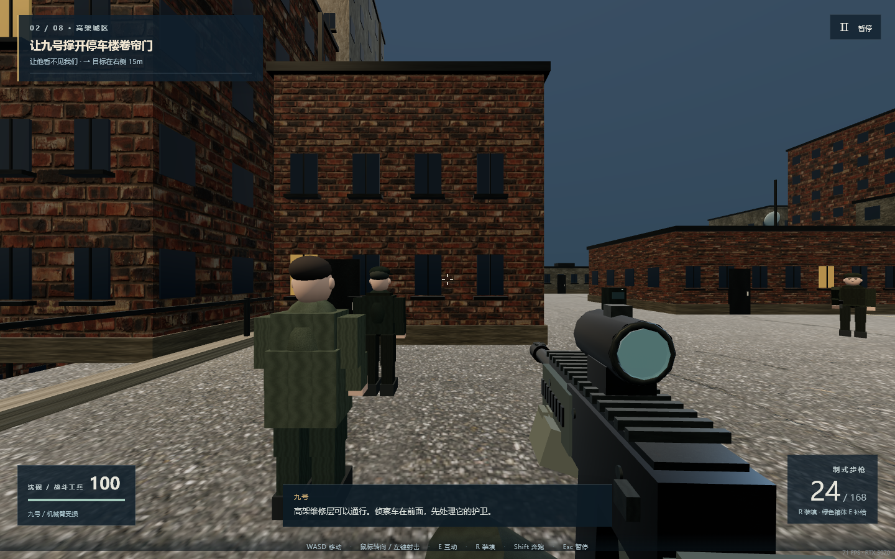
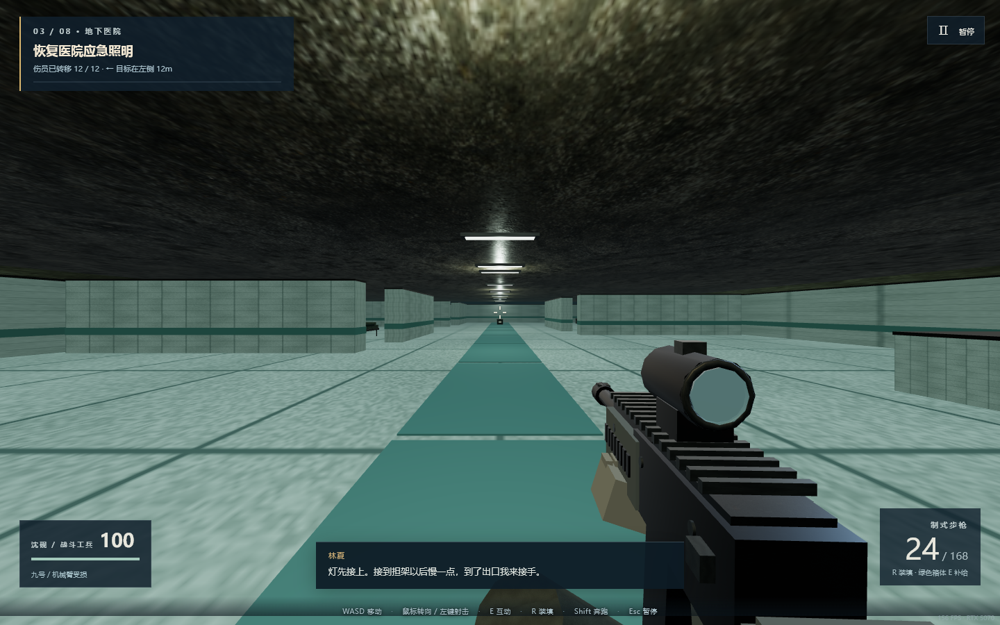
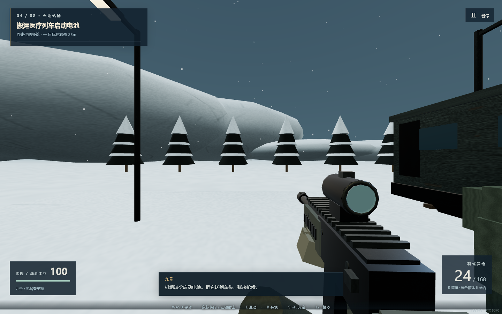
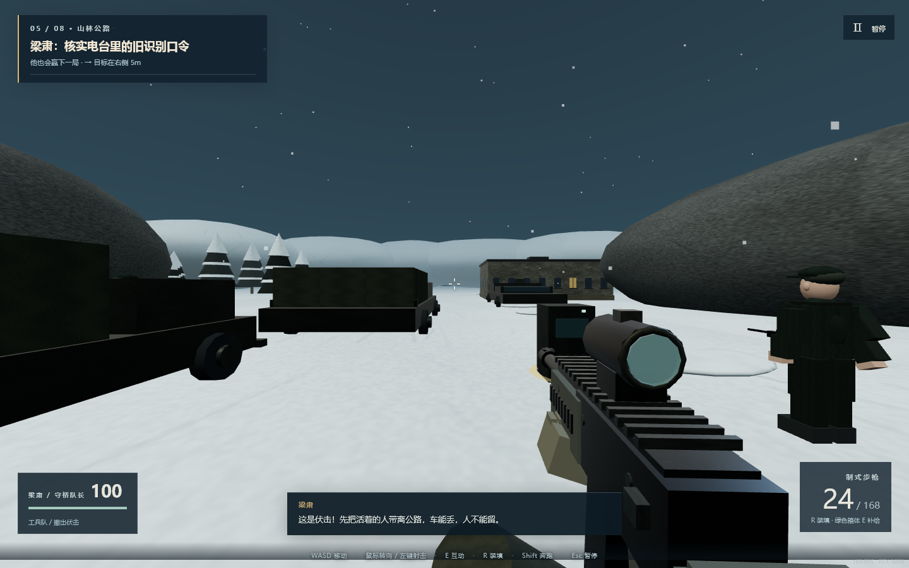
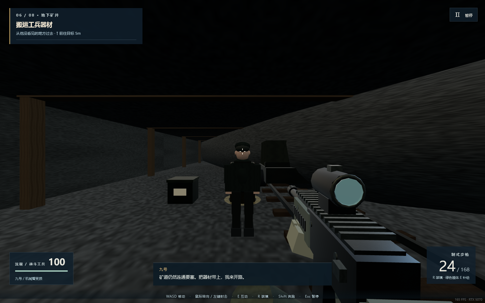
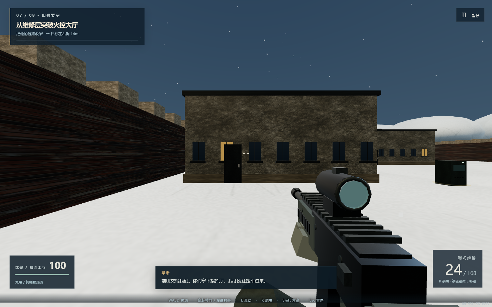
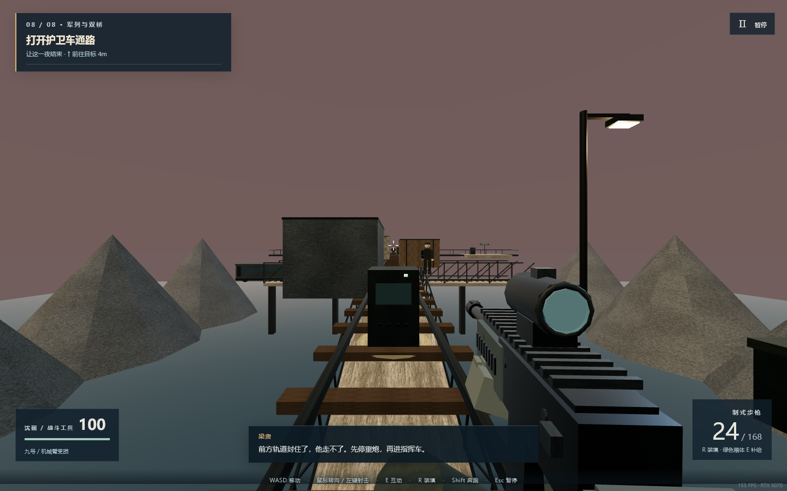
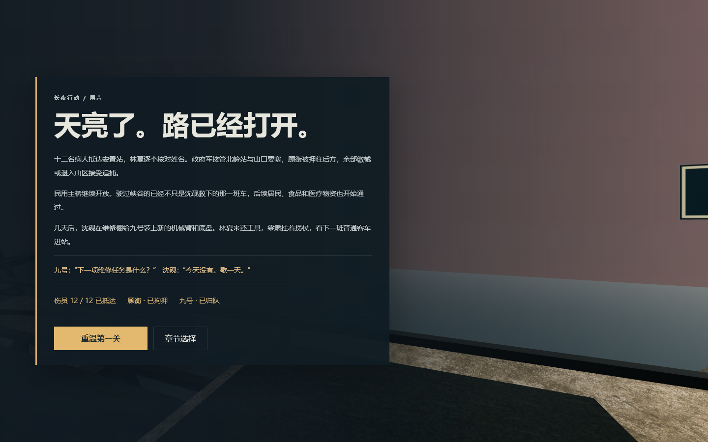

# 验收记录

日期：2026-11-11。运行环境：Windows、Node.js、Chrome 157、WebGL2；浏览器报告使用 NVIDIA GeForce RTX 5070 Laptop GPU。所有运行资源均从本机服务载入。

## 逻辑验证

`npm run check` 通过：17 个必要文件、八关、九张贴图 SHA-256、脚本语法；在线运行依赖为零。

`npm test`：9 项通过，0 项失败。完整通关用普通难度、关闭辅助瞄准，代理只通过移动、瞄准、射击、装填和互动输入推进，无传送、无无敌、无阶段跳过。5782 步、零死亡；十二人获救；顾衡第七关承受六次伤害，第八关承受十次伤害后才可拘押；九号撤离、民用桥保留、军用支桥毁坏。

其余专项覆盖路径可达性、暂停冻结、保存后跨实例继续、墙体与边界碰撞、死亡检查点、三维射线遮挡、补给冷却及空弹药应急补给。需要设置初始资源或位置的边界专项在测试标题中明确标注。

## 浏览器验证

实际 Chrome 页面使用状态读取导航代理完成八关、5758 步，章节简报与过关按钮均由可见界面点击。游戏逻辑按 0.04 秒步进，持续调用实际 WebGL 渲染；批次之间暂停逻辑输入，避免与前端键盘输入竞争。未替换战斗结果或直接设置任务完成状态。最终页面和战略结果均核对通过，运行错误为零。

完整阶段、Boss 血量变化和按钮记录见 [browser-validation.json](browser-validation.json)。该轮采用前端默认的故事难度与辅助瞄准。代理能读取状态并精确瞄准，模拟耗时不代表人的通关时长。

另以真实键鼠事件验证：W 移动；快速单击消耗一发弹药（24→23）；R 装填回到24发并扣除一发储备；Esc 暂停、设置滑块方向键调整、保存后恢复均通过。修复了快速单击可能落在两帧之间导致漏开枪的问题。

最终景观修复后重新载入并逐一进入八张地图，核对第一人称、92°视野与独显报告，无运行错误。刷新后“继续战役”可恢复尾声；390×844 窄窗口的尾声卡片与菜单均无横向溢出。补给箱、检查点和弹药边界由上述逻辑专项覆盖。

实机截图：

| 旧城 | 高架城区 |
| --- | --- |
|  |  |
| 地下医院 | 雪地站场 |
|  |  |
| 山林公路 | 地下矿井 |
|  |  |
| 山巅要塞 | 装甲军列 |
|  |  |

## 适用范围

验证证明此版本能启动、完成八关并正确保存结果。未覆盖其他显卡、其他操作系统或长期压力运行，也未由玩家逐关人工验收。默认流畅画质下的浏览器帧率显示仅供观察，不作为性能基准。

画面采用轻量程序模型与贴图，尚无真人配音、复杂动作捕捉或电影级演出；这是可通关的小型原创战役。
